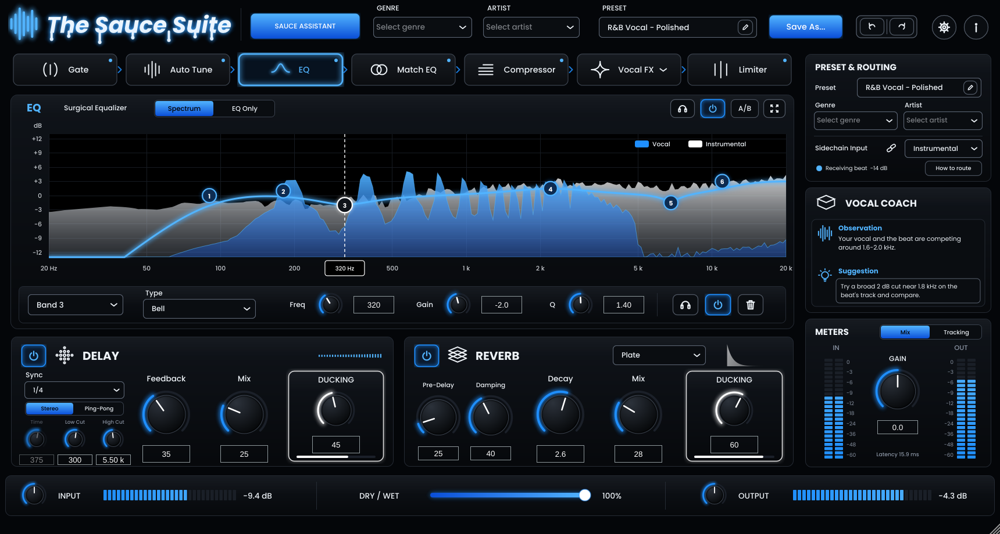
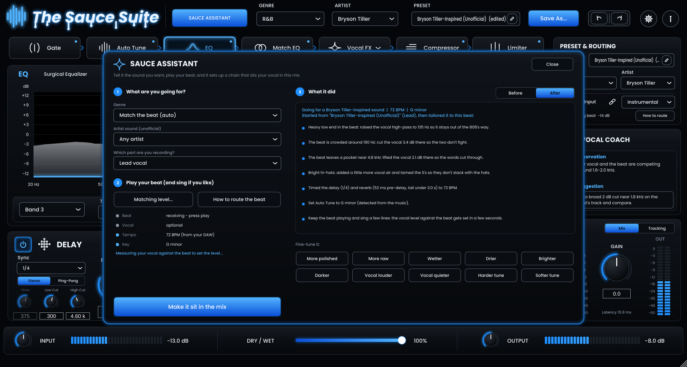

# The Sauce Suite 1.5.0

An all-in-one vocal plugin for rap, melodic rap, trap-soul and R&B vocals: noise gate, key-aware pitch correction, 6-band EQ with a live spectrum, Match EQ, compressor, saturation, doubler and width, tempo-synced delay, reverb with independent ducking, final limiter, factory and user presets, and a Vocal Coach that listens to your vocal next to your beat.

Formats: **VST3** (Windows, macOS, Linux) and **Audio Unit** (macOS). Built with C++17, JUCE 8.0.15 and CMake.



## New in 1.5

* **Fully serial chain:** every module (Gate, De-Pop, Auto Tune, EQ, Match EQ, Comp, De-Ess, Vocal FX, Delay, Reverb, Limiter) is a draggable tab, and the sound runs through them left to right.
* **De-Esser** and **De-Pop** (plosive filter), both zero latency.
* **Smoother Auto Tune** with a Smoothness knob that keeps your vibrato.
* **Limiter** with Drive, Character (Clean / Punchy / Loud) and a ceiling down to -30 dB, movable anywhere.
* **12-band EQ** with Pro-Q-style dynamic bands and a Soothe-style **resonance suppressor**.
* **Track Link:** hear your beat or a reference from another track without sidechain routing; **drag and drop** beat and reference files.
* **Track roles:** Lead / Hook / Ad-libs / Backgrounds / Harmonies / Doubles detection, and a Vocal Coach that gives advice for that part.
* **943 presets**, 152 artists, each with Lead, Hook, Ad-libs and Backgrounds versions. Brighter, graffiti-style look.

## Sauce Assistant (new in 1.4)

Click **SAUCE ASSISTANT** in the header. Choose the sound you want (a genre, an artist sound, or *Match the beat*) and the part you're recording (Lead, Hook, Ad-libs, Backgrounds, Harmonies, Doubles). Then route your beat to the sidechain, press **Start listening** and play 10-20 seconds of the song. **Make it sit in the mix** picks the best starting preset and tailors it to that beat: high-pass vs the 808, a cut where the beat is crowded, a lift where it leaves room, air vs the hats, compression vs density, ducking vs busyness, tempo-synced delay and reverb, the Auto Tune key, and the vocal level against the beat (measured on the new sound). Every change is explained. Use Before/After to compare, and the feedback buttons (More polished, More raw, Wetter, Drier, Brighter, Darker, Louder, Quieter, Harder/Softer tune) to fine-tune. The genre guess is an estimate from tempo and tonal balance, and your own choice always wins.



**Rearrangeable chain:** drag the module tabs to reorder Gate, Auto Tune, EQ, Match EQ, Vocal FX and Compressor (the Limiter stays last). Presets bring their own order, and the order is saved with sessions.

---

## Signal flow

```
(default order shown; the six modules from Gate to Saturation can be dragged into any order)
Vocal in ─► Input gain ─► Gate ─► Auto Tune ─► EQ (6 bands) ─► Match EQ ─► Compressor ─► Saturation/Doubler/Width ─┬─► dry lead ─────────────┐
                                                                         │                                         ├─► Delay  ─► × Delay ducker ─┤
                                                     dry lead (detector) ┴──► voice activity ──► duckers           └─► Reverb ─► × Reverb ducker ┤
                                                                                                                                                 ▼
                                                                                         Dry/Wet ─► Output gain ─► Limiter ─► Vocal out
Instrumental sidechain ─► analyser + Vocal Coach only (never reaches the output)
```

* A stereo vocal track is summed to a **centred mono lead**. Doubler and width add stereo around it, and the delay and reverb returns are stereo.
* Delay and reverb run **in parallel**, both fed by the processed vocal. Each has its own ducking knob, driven by the **dry lead**, so you can duck the reverb hard and leave the delay alone, or the other way round. Ducking works with no beat connected.
* The limiter comes **after** the effect returns, so echoes and tails stay under the ceiling.
* **Latency (switch in the Meters panel):**
  * **Mix:** 762 samples at 48 kHz (about 15.9 ms: pitch correction 14.4 ms plus limiter look-ahead 1.5 ms). It's constant, reported to the DAW, and the same whether Auto Tune is on or off, so plugin delay compensation stays aligned. Use it for mixing.
  * **Tracking:** 24 samples (0.5 ms) reported, for recording through the plugin. Tuned notes arrive one cycle of the sung note later (2.8 ms at 440 Hz, 5.0 ms at 220 Hz, 7.3 ms at 147 Hz); everything else arrives in 0.5 ms. The limiter runs with no look-ahead and still holds the ceiling exactly.
* **Auto Key** (Auto Tune page) estimates the key from your vocal pitch, plus the beat's chords if routed, and sets Key/Scale. It runs in the analysis thread, never the audio path, so it adds no latency.

## Features at a glance

| Module | Controls |
|---|---|
| Gate | Threshold, attack, hold, release, range (attenuation). Hysteresis and hold keep quiet word endings. |
| Auto Tune | Auto Key (on/off, adds no latency), key, scale (major, minor, harmonic minor, pentatonic major/minor, blues, chromatic), retune speed (0 ms = hard tune), correction amount, humanize, plus "Natural" and "Hard Tune" quick buttons. Breaths and unvoiced consonants bypass the shifter. |
| EQ | 6 bands: bell, low/high shelf, low/high cut, notch. Frequency, gain, Q and per-band bypass. Drag nodes on the graph, scroll the mouse wheel to change Q, double-click a node to bypass it. Band solo (headphones), A/B snapshots, enlarge button, Spectrum / EQ Only view. Vocal spectrum is neon blue; the routed instrumental is white. |
| Match EQ | Capture your vocal; capture a reference vocal from the sidechain or load an acapella file; preview the suggested curve, then apply it. Strength, smoothing and max boost/cut stay adjustable after applying, with A/B and reset. The reference vocal is kept separate from the beat. |
| Compressor | Threshold, ratio, attack, release, makeup, gain-reduction meter and live transfer curve. |
| Vocal FX | Saturation (drive, mix), doubler (amount), width/chorus (amount), each with its own on/off. |
| Delay | Free time in ms or tempo sync (1/32 to 1/1, straight/dotted/triplet), feedback, low/high cut in the feedback path, stereo or ping-pong, mix, Delay Ducking. |
| Reverb | Room, plate or hall; pre-delay, decay, damping, mix, Reverb Ducking. |
| Limiter | Ceiling, release, gain-reduction meter (look-ahead peak limiter). |
| Presets | 943 factory presets in 19 categories. Choosing a Genre loads its Lead preset; the Artist menu lists only artists that fit that genre and loads the artist's preset; a pop-up shows what changed. Preset list, Save As, undo/redo. Factory presets can't be overwritten. Edits you haven't saved still come back exactly when the DAW session reopens. |
| Vocal Coach | Answers "What am I hearing?" and "What should I try?" from about 4 seconds of measured audio: clipping, sibilance, low-mid build-up, uneven level, low level, and vocal-vs-beat masking with the frequency range named. Shows "Listening" when there isn't enough audio. |

### Factory presets (943)

* **19 genre categories:** Rap, Melodic Rap, Trap, Drill, Trap-Soul, R&B, Boom Bap, Pop, Afrobeats, Dancehall, Latin / Reggaeton, Gospel, Country, Rock, Indie / Alt, EDM, Lo-Fi, Podcast / Voice, FX & Creative.
* **Every music genre** has 18 roles: Lead, Hook, Hook (Stadium), Ad-libs, Ad-libs (Phone Filter), Ad-libs (Echo Throw), Backgrounds, Backgrounds (Airy Pad), Harmonies (Wide), Doubles, Intro / Whisper, plus seven lead flavours: Clean, Dark, Bright, Spacey, Hard Tune, Vintage and Aggressive. Presets also set the chain order. Each genre's settings come from its own recipe (EQ curve, tuning style, compression, saturation, delay and reverb), so they all sound different.
* **FX & Creative:** Telephone, Megaphone, AM Radio, Underwater, Robot, Whisper Air, Stadium Throw, Echo Out (Dub), Distorted Scream, Choir Stack, Infinite Wash, Vinyl Tape Echo.
* **152 artist-inspired styles** (Lead, Hook, Ad-libs and Backgrounds each), marked **(Unofficial)** and listed under the genres that fit each artist (e.g. Drake, J. Cole, Rylo Rodriguez under Rap/Trap; Bryson Tiller, Tory Lanez, Chris Brown, SZA, Summer Walker under R&B), plus the original genre presets. Not affiliated with or endorsed by the artists.

The full table is in [docs/FACTORY_PRESETS.md](docs/FACTORY_PRESETS.md). Use **Genre** in the header to show one genre's presets.

The artist-inspired presets are rough starting points based on how those artists' released vocals commonly sound. They aren't affiliated with or endorsed by the artists, and they shape **your vocal's processing**, not your voice. If you ever sell the plugin, rename them (e.g. "Toronto Dark") so artist names aren't used to market it.

---

## Verification (what was actually tested)

Version 1.5.0: **130/130 checks pass** on Linux and on the Windows build under Wine. See [docs/test-results.txt](docs/test-results.txt) and [docs/test-results-windows.txt](docs/test-results-windows.txt); the changes are listed in [CHANGELOG.md](CHANGELOG.md).

These checks ran on Linux (Ubuntu 24.04, GCC 13, JUCE 8.0.15, 48 kHz, 512-sample blocks). Every check feeds audio through the real `processBlock()` with the vocal on the main bus and the beat on the sidechain bus, the same way a DAW does. Full output: [docs/test-results.txt](docs/test-results.txt).

| Check | Result |
|---|---|
| Flat sung note (A4 −39 cents, C major, retune 0 ms) | Output measured **+0.9 cents** from A4 |
| Out-of-scale / other key | F4 +30 c → F4 (+0.6 c); A#4 −35 c in D# minor → A#4 (−1.2 c); Amount 50% → −20 c (partial correction) |
| Breath / consonant noise through Auto Tune | Correlation 1.0000 with the latency-aligned input (left untouched) |
| Ducking during a phrase | Delay Ducking 100%: delay return −24.6 → −60.6 dB, reverb unchanged (−26.6 vs −26.6). Reverb Ducking 100%: reverb −26.6 → −62.6 dB, delay unchanged. At 0% both play normally. Tails rise back by about 24 dB in the gap after the phrase. Run with no sidechain connected. |
| Beat on sidechain, vocal silent | Output peak −200 dBFS (digital silence) for 12 s with every effect on. A vocal phrase followed by silence renders **bit-identical** with and without the beat. |
| Match EQ (known +6 dB high shelf) | High/mid balance moved 7.9 → 12.2 dB with a 4 dB limit (curve peak 4.00 dB) and → 12.8 dB with a 12 dB limit (reference 13.8 dB). A/B off restores the original tone. |
| Presets and session | Save As with a factory name creates "(My Version)"; the factory original is unchanged; the user preset reopens exactly; a session with unsaved edits restores all 86 parameters, the preset name, the edited flag and the filters, and renders sample-identical audio. |
| Analyser and Vocal Coach | Spectrum peak tracks 1 kHz / 5 kHz inputs and a 120 Hz beat. Coach shows "Listening" on silence and on under 1.2 s of voice. It names a low-mid build-up ("around 320 Hz"), sibilance ("around 6.5 kHz"), and vocal/beat competition ("around 320–400 Hz … cut near 360 Hz on the beat's track"), then goes back to "Listening" when the audio stops. |
| Latency, bypass, mono | Reported latency equals the measured impulse delay. Bypass is latency-compensated and exact. Mono tracks are supported. |

**Plugin binary in a host:** the compiled Linux VST3 was loaded through JUCE's VST3 hosting code (`SauceHostCheck`, the same path a DAW uses). It was scanned, instantiated, had its sidechain enabled, processed audio, reported latency, gave silent output with only the sidechain playing, opened and resized the editor, and restored state through the VST3 wrapper ([docs/host-check.txt](docs/host-check.txt)).

**Not yet verified:** Windows and macOS builds (they're set up in the GitHub workflow but haven't run yet), the Audio Unit and `auval`, and real DAWs (FL Studio, Ableton Live, Logic, Studio One, Reaper, Cubase). Please test those and report anything odd.

---

## Getting the plugin

### Option A: let GitHub build it for you (recommended)

1. Create a free account at github.com and a new **empty repository** (e.g. `the-sauce-suite`).
2. Upload this folder's contents to it (GitHub's web "Add file → Upload files" works, or `git push`). Keep the `.github` folder; it contains the build instructions.
3. Open the repository's **Actions** tab. A run called "Build The Sauce Suite" starts on its own and takes about 10–25 minutes.
4. When it's green, open the run and download **TheSauceSuite-Windows** or **TheSauceSuite-macOS** from *Artifacts*.
5. To make a downloadable release, create a tag like `v1.0.0` (Releases → *Draft a new release* → new tag). The zips get attached to it.

### Option B: build it yourself

Requirements: **CMake 3.22+** and Git, plus:

* **Windows:** Visual Studio 2022 with "Desktop development with C++".
* **macOS:** Xcode 14+ (builds a universal arm64 + x86_64 binary; macOS 10.13+).
* **Linux:** `sudo apt install build-essential cmake git libasound2-dev libx11-dev libxrandr-dev libxinerama-dev libxcursor-dev libxcomposite-dev libxext-dev libfreetype-dev libfontconfig1-dev`

```bash
cmake -S . -B build -DCMAKE_BUILD_TYPE=Release     # downloads JUCE 8.0.15
cmake --build build --config Release --parallel
# optional checks
build/SauceTests_artefacts/Release/SauceTests
build/SauceHostCheck_artefacts/Release/SauceHostCheck "build/TheSauceSuite_artefacts/Release/VST3/The Sauce Suite.vst3"
```

Already have JUCE? Pass `-DJUCE_DIR=/path/to/JUCE` (8.0.15 is the tested version). On macOS, sign the result for local use with `codesign --force --deep -s - "The Sauce Suite.vst3"` (same for `.component`).

Outputs: `build/TheSauceSuite_artefacts/Release/VST3/The Sauce Suite.vst3` and, on macOS, `.../AU/The Sauce Suite.component`.

### Install

| OS | Copy to |
|---|---|
| Windows | `C:\Program Files\Common Files\VST3\` (copy the whole `The Sauce Suite.vst3` folder) |
| macOS VST3 | `~/Library/Audio/Plug-Ins/VST3/` |
| macOS AU | `~/Library/Audio/Plug-Ins/Components/` |
| Linux | `~/.vst3/` |

Then rescan plugins in your DAW. The plugin isn't notarized or code-signed with a paid certificate:

* **Windows** may show a SmartScreen prompt when you extract the files; choose *More info → Run anyway*, or unblock the zip in its Properties first.
* **macOS** may say the plugin "can't be opened". Run `xattr -dr com.apple.quarantine ~/Library/Audio/Plug-Ins/VST3/"The Sauce Suite.vst3"` (and the same for the `.component`), then rescan.

---

## DAW walkthrough

**1. Insert it on your vocal.** Put The Sauce Suite as an insert on your lead vocal track (mono or stereo). Pick a preset from **Preset**, or narrow the list with **Genre** / **Artist** first. Set **Auto Tune → Key/Scale** to your song's key.

**2. Route your beat to the sidechain (optional, for the analyser and Vocal Coach).**
* *Logic Pro (AU):* plugin header → **Side Chain** → choose the beat track.
* *Studio One / Cubase:* enable the plugin's sidechain, then pick the beat track as its source.
* *Reaper:* route the beat track to channels 3/4 of the vocal track.
* *FL Studio:* right-click the beat mixer track's route arrow into the vocal track → **Sidechain to this track**, then map it to the plugin's second input in the wrapper's Processing settings.
* *Ableton Live:* if the device shows a Sidechain section, pick the beat track there. If not, the Coach still gives vocal-only feedback, and Match EQ can load a reference file.

In **Preset & Routing**, set **Sidechain Input = Instrumental**. The status dot turns blue and shows "Receiving beat" with the level. The white spectrum appears behind your vocal, and the Coach starts checking for frequency clashes. The beat is never mixed into the plugin's output.

**3. Match a reference vocal (optional).** On the **Match EQ** tab, click **Capture My Vocal** and play 10–30 s of your verse and hook. Then either **Load Reference Vocal File…** (an acapella) or set the sidechain to *Reference Vocal* and click **Capture Reference**. Check the dashed suggested curve, click **Apply Match**, and use **A/B**, Strength, Smoothing and Max Boost/Cut.

**4. Save and recall.** Click **Save As…** to name your version and tag it with a genre or artist. Factory presets are never overwritten; saving under a factory name creates "… (My Version)". User presets are stored here (gear menu → *Show presets folder* opens it):
* Windows: `%APPDATA%\Drellmadeit\The Sauce Suite\Presets`
* macOS: `~/Library/Drellmadeit/The Sauce Suite/Presets`
* Linux: `~/.config/Drellmadeit/The Sauce Suite/Presets`

You don't have to save to keep your sound. Your DAW project stores the exact current state, including unsaved tweaks, the applied Match EQ curve and your genre/artist filters, and restores it when you reopen the session.

---

## Limitations and notes

* Pitch correction is for a **single (monophonic) lead vocal**. Stacks, chords and harmonies through one instance won't track correctly.
* At about 16 ms, latency is fine for mixing and usually fine for tracking with DAW compensation. If monitoring through the plugin feels late while you record, bypass Auto Tune's instance during tracking or use your DAW's low-latency mode.
* Match EQ captures your vocal **after** the 6-band EQ, so it corrects what's left after your own EQ moves.
* The Coach can name an individual instrument only if that instrument's stem is what you route. A full beat is always called "the beat".

## Project layout

```
CMakeLists.txt            JUCE 8.0.15 pinned (FetchContent), VST3/AU targets, tests, host check
Source/dsp/               pure C++ DSP (no JUCE): gate, pitch, EQ, Match EQ, dynamics, effects, analysis, coach
Source/                   processor, parameters, presets (factory + user), analysis thread, editor
Source/ui/                look-and-feel, header, EQ graph, module pages, delay/reverb, side panels
Resources/fonts/          Poppins (SIL OFL 1.1)
tests/SauceTests.cpp      the verification runner (also renders UI snapshots: --snapshot out.png <tab>)
tools/HostCheck.cpp       loads the built VST3 the way a DAW does
.github/workflows/        automatic Windows / macOS / Linux builds
docs/                     screenshots, preset table, test and host-check output
```

## Licenses you need to know about

| Component | License | What it means for you |
|---|---|---|
| **JUCE 8** | Dual: **AGPLv3** or the **JUCE licence** (free *Starter* tier for small revenue; paid Indie/Pro above it) | Free plugins or small sales: the free Starter tier lets you keep your code closed, up to its revenue limit (currently about $20k a year; check juce.com before selling). Otherwise, release your source under AGPLv3 or buy a JUCE licence. |
| **VST3 SDK** (bundled with JUCE 8.0.15) | **MIT** (since VST 3.8) | Free to use commercially; keep Steinberg's copyright notice. The "VST" logo is optional, and if you use it you must follow Steinberg's usage guidelines. |
| **Audio Unit SDK** (Apple) | Apple's terms (comes with Xcode) | Nothing extra to sign. |
| **Poppins font** | SIL Open Font License 1.1 (`Resources/fonts/OFL-Poppins.txt`) | Free to embed; keep the license file with the source. |
| **Your code** (everything in `Source/`, `tests/`, `tools/`) | Yours | Choose your own license. If you use JUCE under AGPLv3, your plugin must be AGPLv3 too. |

The build machine used for verification had no Linux X11 extension headers installed. It used small stand-in headers that are **not part of this project**; the Windows, macOS and normal Linux builds don't need them.

## Mac version (one click on any Mac)

1. Copy this folder to a Mac and double-click **Build-Mac.command**. The first time, right-click it and choose **Open**, or run `bash Build-Mac.command` in Terminal.
2. If asked, install Apple's free Command Line Tools, then run it again. It downloads CMake and JUCE by itself.
3. About 10–20 minutes later it has built the universal VST3 and AU, run the tests, checked the AU with `auval`, and opened **dist/TheSauceSuite-<version>-macOS.pkg**. Click through the installer, then rescan plugins.

Because the plugin is built on that Mac, macOS doesn't flag it as a download. To hand the .pkg to other people without Gatekeeper warnings, it needs an Apple Developer ID ($99/year) to sign it and Apple's notarization; the script has a clear place to add that later.

## Windows build without Visual Studio (cross-compiled)

`TheSauceSuite-Windows.zip` was cross-compiled on Linux with **llvm-mingw** (clang 21, UCRT, fully static, no extra runtime DLLs). JUCE 8 officially supports only MSVC/clang-cl on Windows, so this build applies a small compatibility patch to JUCE 8.0.15 (`cmake/juce-8.0.15-mingw.patch`: 64-bit detection, three missing SDK constants, explicit `__uuidof` types). To reproduce it:

```bash
cp -r JUCE JUCE-win && cd JUCE-win && patch -p1 -d . < ../TheSauceSuite/cmake/juce-8.0.15-mingw.patch   # (run from a folder containing both)
cmake -S TheSauceSuite -B build-win -G Ninja -DCMAKE_BUILD_TYPE=Release \
      -DCMAKE_TOOLCHAIN_FILE=cmake/mingw-w64-clang.cmake -DJUCE_DIR=$PWD/JUCE-win
cmake --build build-win --target TheSauceSuite_VST3
```

The installer (`installer/`) is a small Win32 program that embeds the plugin and copies it to `C:\Program Files\Common Files\VST3`. Run it again to update or uninstall. Silent switches: `/S` installs, `/S /U` uninstalls.

The Visual Studio build from the GitHub workflow is still the reference build. Use it whenever it's available.
